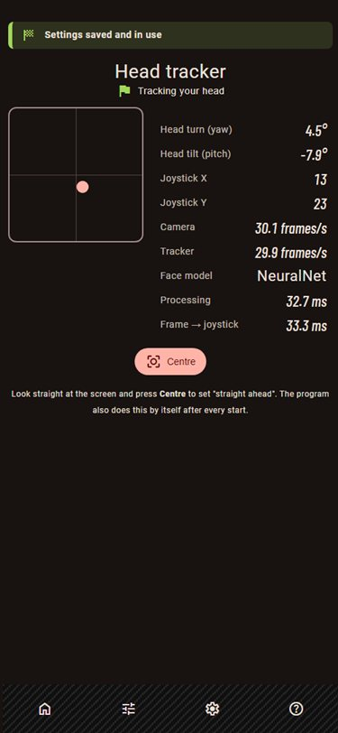
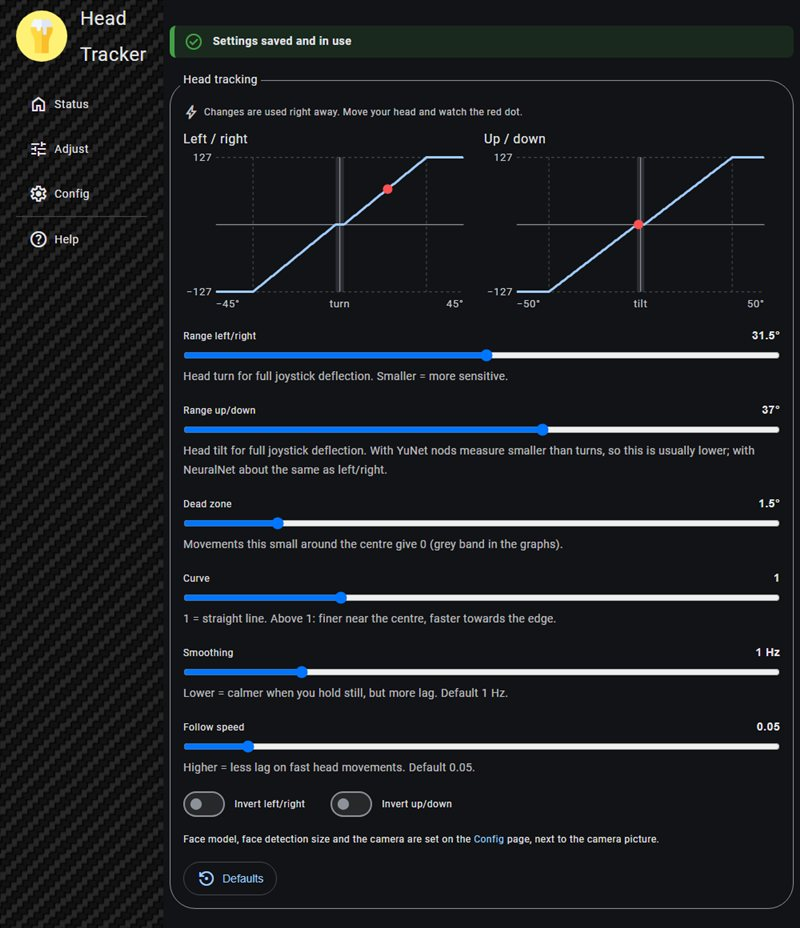
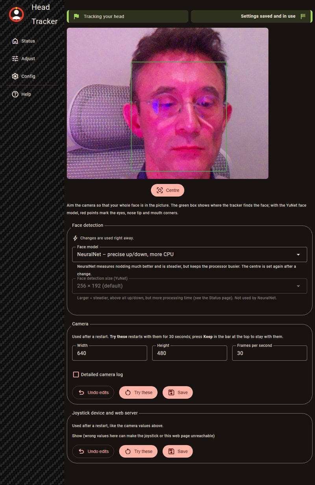
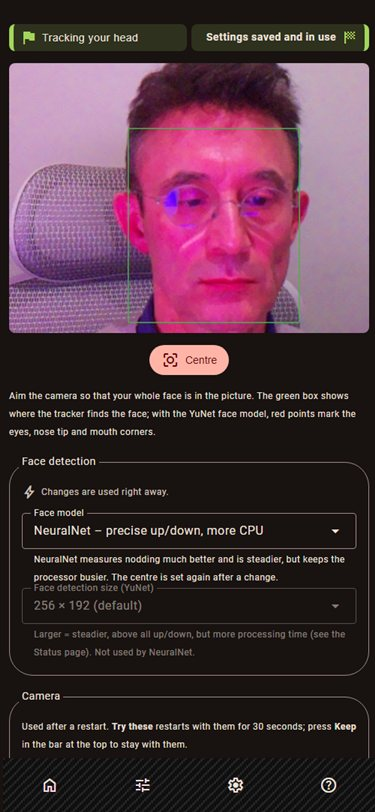
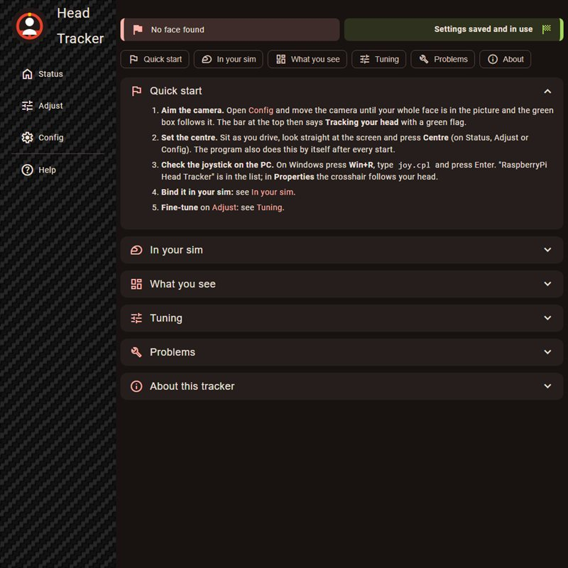

# RPiUSBHeadTracker


A Raspberry Pi head tracker that a PC sees as an ordinary USB joystick.

The Pi is plugged into the PC with a USB cable. It registers as a USB game controller, so games and simulators that can use a joystick need no extra driver or software. A camera on the Pi watches the player, and the program turns the camera picture into joystick movements. A small web interface lets you check the camera picture and change the settings from any browser.

> **Status: work in progress.** Head tracking works: turning the head moves X, tilting it moves Y. Sensitivity, dead zone and smoothing are set on the Adjust page, camera and face model on the Config page; the Status page shows the tracker live and has a Centre button. With `install_service.sh` the program starts at boot and again after a crash.

## How it works

```
 camera ──► RPiUSBHeadTracker ──► /dev/hidg0 ──► USB cable ──► PC: "HID-compliant game controller"
                   │
                   └──► web interface (port 18080) ──► browser on PC or phone
```

- **USB joystick:** `headtracker_device.sh` turns the Pi's USB port into a HID joystick (Linux USB gadget). The program writes joystick reports to `/dev/hidg0`: two axes (X, Y, each −127 … 127) and 32 buttons.
- **Camera:** read through libcamera and OpenCV (via the LCCV library), in its own thread.
- **Head tracking:** for every camera frame, a face model works out how far the head is turned (yaw) and tilted (pitch). There are two to choose from: **YuNet** finds the face and five points on it (eyes, nose tip, mouth corners) and the program computes the angles from these points; **NeuralNet** gets the angles straight from a neural network and measures nodding much better, but needs more processing power. The program smooths the values and turns them into joystick X and Y. See [Head tracking](#head-tracking).
- **Web interface:** a small built-in web server (Crow) with three pages: Status, Adjust and Config.

## What you need

- **Raspberry Pi 4** (or another Pi whose USB‑C port can work as a USB device, such as the Pi Zero 2 W). Tested on a Pi 4 with Raspberry Pi OS / Debian 12 "bookworm".
- **Raspberry Pi camera**, tested with the Camera Module v2 (IMX219).
- **USB cable** from the Pi's USB‑C port to the PC. The Pi is also powered through this cable.

**Memory:** with the YuNet face model the running program needs about 100 MB: about 76 MB of RAM (measured on a Pi 4 with the camera at 640 × 480, 30 frames per second, face detection at 256 × 192) plus about 21 MB of the memory reserved for the camera (CMA). The NeuralNet face model adds about 50 MB (measured: 72 MB → 121 MB of RAM). So it fits on a Pi with 512 MB when Raspberry Pi OS Lite (no desktop) is used; 1 GB or more leaves plenty of room. Building needs much more: on 512 MB build with `ninja -C build -j1` and swap, or build on a bigger Pi and copy the build folder.

**Processing power:** YuNet takes about 20 ms per frame on a Pi 4; NeuralNet about 25 ms and keeps all four cores busy, so it is meant for a Pi 4 or 5 at up to 30 frames per second.

## Setup on the Pi

### 1. Let the USB port work as a device

Add this line to `/boot/firmware/config.txt` and reboot:

```
dtoverlay=dwc2,dr_mode=peripheral
```

### 2. Install the build tools and libraries

```bash
sudo apt install cmake ninja-build g++ libopencv-dev libcamera-dev libssl-dev libasio-dev
```

CMake 3.24 or newer is needed (bookworm has 3.25).

Optional, for the unit tests:

```bash
sudo apt install libgtest-dev
```

### 3. Build

```bash
cmake -S . -B build -G Ninja -DCMAKE_BUILD_TYPE=Release
ninja -C build
```

The first `cmake` run needs an internet connection: it downloads the libraries listed under [Libraries](#libraries) into `build/_deps`, and the face models into `build/models`. Later builds in the same build folder use these copies.

The NeuralNet face model needs ONNX Runtime. CMake downloads its ready-built library (64-bit ARM Linux only, so a 64-bit Raspberry Pi OS is needed). On other systems, or with `-DRPIHT_NEURALNET=OFF`, the program is built with YuNet only; the Config page then shows NeuralNet as "not built in".

### 4. Create the USB joystick

```bash
sudo bash headtracker_device.sh
```

The PC now finds a new game controller called "RaspberryPi Head Tracker". When the script is started with `sudo`, it gives `/dev/hidg0` to your user, so the program can run without root. You can run the script again at any time; if the joystick is already set up, it does nothing. The setup is lost on reboot; step 7 makes this happen at every start.

### 5. Create the config file

The program reads its settings from `/etc/USBHT.json`, or from the file given with `-c`. Example:

```json
{
   "device": "/dev/hidg0",
   "ip": "0.0.0.0",
   "port": 18080,
   "cam_width": 640,
   "cam_height": 480,
   "cam_framerate": 80.0,
   "cam_verbose": false
}
```

| Key | Meaning |
|---|---|
| `device` | The joystick device created in step 4, normally `/dev/hidg0`. |
| `ip` | Address the web interface listens on. `0.0.0.0` means all network connections of the Pi. Optional. |
| `port` | Port of the web interface. |
| `cam_width`, `cam_height` | Camera picture size in pixels. |
| `cam_framerate` | Camera frames per second. |
| `cam_verbose` | `true` writes detailed camera messages to the log. |
| `track_range_x`, `track_range_y` | Degrees of head turn (X) or tilt (Y) for full joystick deflection. Optional, default 20 for X and 10 for Y. |
| `track_deadzone` | Degrees around the centre that give 0. Optional, default 1.5. |
| `track_curve` | 1 = linear; above 1 finer near the centre and faster towards the edge. Optional, default 1. |
| `track_smoothing` | Smoothing while the head is still, in Hz: lower = calmer, but more lag. Optional, default 1. |
| `track_speed` | How quickly the smoothing lets fast movements through: higher = less lag. Optional, default 0.05. |
| `track_invert_x`, `track_invert_y` | `true` reverses the direction of X or Y. Optional, default `false`. |
| `track_detect_width` | Width in pixels the camera picture is shrunk to for face detection with YuNet; the height keeps the camera's aspect ratio. Larger = steadier, above all up/down, but slower. Optional, default 256. |
| `track_model` | Face model: `"yunet"` or `"neuralnet"` (see [Head tracking](#head-tracking)). Optional, default `"yunet"`. |

When you press **Save** in the web interface, the program writes this file itself and adds the keys `saved` and `active`. Your user needs write permission for the file.

### 6. Start

Start the program from the build folder, because it loads the web pages from the `templates` and `static` folders there:

```bash
cd build
./RPiUSBHeadTracker -c ~/USBHT.json
```

| Option | Meaning |
|---|---|
| `-c`, `--configfile` | Full path to the config file. Default: `/etc/USBHT.json`. |
| `-h`, `--help` | Show the options. |

Stop it with **Ctrl+C**, or `pkill -x RPiUSBHeadTrack` from another terminal. The program then closes the camera, the web server and the joystick device cleanly.

### 7. Start at boot

```bash
sudo bash install_service.sh ~/USBHT.json
```

This installs two systemd services and starts them right away:

| Service | Does |
|---|---|
| `headtracker-gadget` | Creates the USB joystick at boot (`headtracker_device.sh`) and gives `/dev/hidg0` to your user. |
| `headtracker` | Starts the program as your user, from the build folder, with the given config file. After a crash it starts the program again within 3 seconds (at most 5 times in 2 minutes). |

The first argument is the config file (default `/etc/USBHT.json`), the second the build folder (default `build` next to the script). Run the script again after moving them.

| Command | Does |
|---|---|
| `systemctl status headtracker` | Shows whether the program runs. |
| `journalctl -u headtracker -f` | Shows the program's messages. |
| `sudo systemctl stop headtracker` | Stops the program until the next boot (for example before building, so the compiler has the CPU). `pkill` works too: a normal stop is not restarted. |
| `sudo systemctl start headtracker` | Starts it again. |
| `sudo bash install_service.sh --remove` | Removes both services. |

### 8. Wi-Fi setup without a terminal (optional)

```bash
sudo bash install_wifi.sh ~/USBHT.json
```

When the Pi is on no Wi-Fi network – the first time, or when the known network is gone for 90 seconds – it opens its own open Wi-Fi **HeadTracker-XXXX** (the end of its Wi-Fi address). A phone or PC that joins it gets the setup page by itself (like hotel Wi-Fi: "Sign in to network"), or opens `http://10.42.0.1/setup`. Phones send the requests of a normal browser tab over mobile data when the Wi-Fi has no internet, so then mobile data has to be off; the "Sign in to network" window always uses the hotspot. There the user picks the home network and types its password. The setup page is also on the Config page (**Change Wi-Fi**), with **Forget** for the current network.

> **Careful:** on a Pi you reach over its Wi-Fi, a lost network makes it open the hotspot instead – it is then reachable only there (or over Ethernet).

| Part | Does |
|---|---|
| `headtracker-wifi` service (`wifi/headtracker-wifi.sh`) | Opens the hotspot when the Pi is on no network. Before that it notes the nearby networks for the setup page (the Wi-Fi cannot search while it is a hotspot). While nobody uses the hotspot, it tries the saved networks again every 5 minutes. |
| `headtracker-portal` socket | Port 80 on the hotspot goes to the web server (phones check for internet on port 80). |
| `/etc/NetworkManager/dnsmasq-shared.d/headtracker-captive.conf` | On the hotspot every name points to the tracker, so phones open the setup page. |
| `/etc/polkit-1/rules.d/10-headtracker-wifi.rules` | Lets the program (your user) change the Wi-Fi through NetworkManager. |

Joining a network keeps the old connection to the same network until the new one works. With a wrong password the new one is forgotten, the hotspot opens again and the setup page says why. Company networks (with a user name) and WEP networks are not supported. Wi-Fi changes go through `nmcli` without a shell, so network names and passwords cannot run commands.

`sudo bash install_wifi.sh --remove` removes it all again.

## The web interface

Open `http://<address of the Pi>:18080` in a browser on the PC or on a phone in the same network. The menu on the left switches between the pages. On a phone the menu moves to the bottom of the screen.

The pages follow Material Design 3 (with [BeerCSS](https://www.beercss.com)). The colours are a Material 3 scheme made from racing red (`#e8412b`) in `static/colors.css`, with a light and a dark version; the browser's or the system's setting picks one. Numbers are shown in Barlow Condensed italic, like a timing screen. The logo is `static/logo.svg`.

### Status bar

Every page starts with a bar in two halves of the same width, side by side on every screen. On a phone the buttons in it show only their icons (the name appears as a tooltip), and the detail line is shown only while the program restarts or tries new settings.

**Left, with its flag and colour bar on the left:** what the tracker is doing right now, like a race flag: green "Tracking your head", yellow "Setting the centre …", red "No face found", or "No connection to the tracker".

**Right, with its icon and colour bar on the right:** whether the settings are saved and in use:

| Bar | Meaning | Buttons |
|---|---|---|
| Green, chequered flag: **Settings saved and in use** | The program runs with the values from the config file. | – |
| Yellow: **Changed settings in use – not saved** | You changed head tracking values. They are lost when the program restarts. | **Save** writes them to the file. **Back to saved** returns to the values in the file. |
| Yellow: **Saved, but not in use yet** | Camera or connection values were saved but need a restart. | **Try now** (see [Trying restart settings](#trying-restart-settings)) |
| Blue: **Restarting with the new settings …** | Camera, web server and joystick start again. | – |
| Blue: **Trying new settings – keep them?** | New camera or connection settings run on trial, with a countdown. | **Keep** · **Go back** |
| Red: **Your change was undone – back to the last working settings** | The new settings failed or were not kept; the bar says why. | **OK** |
| Red: **No connection to the head tracker** | The program is not running or the network is down. | – |

### Status


The start page shows the tracker live, about five times per second:

- whether a face is found and the centre position is set (left part of the bar at the top),
- the joystick position as a dot in a square,
- head turn and tilt in degrees, joystick X and Y,
- camera and tracker frames per second, the face model in use, processing time and the time from camera frame to joystick values.

**Centre:** look straight at the screen and press it; the head position of the next frames becomes "straight ahead". The program also does this by itself after every start.

On a phone everything on this page is centred.



The same data is available as JSON at `/state`; `POST /centre` does what the button does. The status bar uses `/status` (`saved`, `active`, `trial`, `failure`); `POST /tracking` (head tracking values as form fields; fields that are not sent stay as they are), `POST /save`, `POST /revert`, `POST /restart`, `POST /keep`, `POST /undo` and `POST /dismiss` do what the Adjust and Config pages and the status bar buttons do.

### Adjust



How head movements become joystick movements. Every change is used right away; nothing restarts and the centre position stays. Two graphs show how head turn (left/right) and head tilt (up/down) become joystick values: the line is the current setting, the grey band the dead zone, and the dot on it shows where your head is now and what the joystick sends. Each graph has its range slider right below it; move a slider and the line changes at once. Below the graphs is the **Centre** button, as on the Status and Config pages.

| Setting | Meaning |
|---|---|
| **Range left/right**, **Range up/down** | Head turn or tilt (degrees) for full joystick deflection. Smaller = more sensitive. |
| **Dead zone** | Movements this small (degrees) around the centre give 0. |
| **Curve** | 1 = straight line. Above 1: finer near the centre, faster towards the edge. |
| **Smoothing** | Lower = calmer when holding still, but more lag. |
| **Follow speed** | Higher = less lag on fast head movements. |
| **Invert left/right**, **Invert up/down** | Reverse the direction of X or Y. |

**Defaults** sets these values back to the program's defaults (face model and detection size on the Config page stay as they are). Changed values are not saved until you press **Save** in the status bar; **Back to saved** there returns to the values in the file.

### Config



Setting up the camera, the face model and the connections. At the top is the live camera picture, updated about ten times per second. Use it to aim the camera at your head. A green box shows where the tracker finds the face; with the YuNet face model, five red points mark the eyes, nose tip and mouth corners. Below the picture is the Centre button. The picture is also available on its own at `/image`.

**Face detection:** used right away, and you see the effect in the picture.

| Setting | Meaning |
|---|---|
| **Face model** | **YuNet** (default) or **NeuralNet**: NeuralNet measures nodding much better and is steadier, but needs more processing power. After a change the centre is set again; look straight ahead for a moment. With NeuralNet, **Range up/down** (Adjust page) can be about as large as left/right. |
| **Face detection size (YuNet)** | Size the camera picture is shrunk to for finding the face. Larger = steadier, above all up/down, but more processing time (shown on the Status page). Not used by NeuralNet. |

**Camera:** used after a restart, see [Trying restart settings](#trying-restart-settings).

| Field | Meaning |
|---|---|
| **Width**, **Height** | Camera picture size in pixels. With the Raspberry Pi camera 640 × 480 is the camera's own smallest size; smaller sizes are shrunk from it. |
| **Frames per second** | Camera frames per second. |
| **Detailed camera log** | Writes detailed camera messages to the log. |

**Joystick device and web server:** used after a restart. The fields are folded away, because wrong values can make the joystick or this web page unreachable.

| Field | Meaning |
|---|---|
| **Joystick device** | The USB joystick device, normally `/dev/hidg0`. |
| **Web server address**, **Web server port** | Address and port the web interface listens on (`0.0.0.0` = all). After a port change, open the web interface at the new port. |

### Trying restart settings

The Camera part and the joystick and web server part of the Config page have the same three buttons. Each sends only the values of its own part:

- **Undo** puts the fields back to the values the page showed when it was loaded.
- **Try** restarts camera, web server and joystick with the new values on trial: press **Keep** in the status bar within 30 seconds, or the last working settings come back. Kept values are not saved yet; the status bar shows that.
- **Save** writes all values to the config file; these ones are used after the next restart.

The explanations in these parts are about the buttons; the status bar at the top says what state the settings are in right now.

A wrong camera size, port or joystick device could make the program unusable or the web page unreachable. So these settings are only tried at first:

1. **Try** remembers the settings the program runs with now (the last working ones) in `<config file>.trial`, for example `/etc/USBHT.json.trial`, and restarts with the new ones.
2. The program checks that the web server answers on its port, the joystick device opens and the camera delivers a picture. If one of these fails, it goes back to the last working settings right away.
3. Otherwise the status bar counts down 30 seconds. **Keep** keeps the new settings; **Go back** or doing nothing brings back the last working settings.
4. If the program stops during the trial (crash, power off), it starts the next time with the last working settings. With the service from step 7, systemd starts it again right after a crash.

After a port change the page moves to the new port by itself once the program answers there. If the new port does not work, the program goes back to the old one after 30 seconds; the page on the old port then shows why.

On a phone the form uses the whole width and the menu is at the bottom:



### Help



Short help for using the tracker, in parts that open with a click (the chips at the top jump to them):

- **Quick start:** aim the camera, set the centre, check the joystick on the PC, bind it in the sim, fine-tune.
- **In your sim:** binding the two axes, the sim's own dead zone and curve, inverting, and [opentrack](https://github.com/opentrack/opentrack) for sims that take head tracking only from TrackIR-type software.
- **What you see:** the flags and colours of the bar at the top, and what each page is for.
- **Tuning:** what to change on Adjust for a symptom ("the view shakes when I hold still", "nodding hardly moves the view" …).
- **Wi-Fi:** setting up the Wi-Fi with the tracker's own hotspot (see [step 8](#8-wi-fi-setup-without-a-terminal-optional)), changing and forgetting a network.
- **Problems:** no face found, the PC does not see the joystick, settings undone, the page gone after a port change, no connection.
- **About this tracker:** version, name and addresses of the Pi, camera, face model, joystick device, config file, running time and OpenCV version, from `/info` (JSON).

The **?** next to a heading on the other pages opens the matching part, for example `/help#tuning` from Adjust.

The version is set in `project()` in `CMakeLists.txt` (now 0.1.0); release tags must match it.

## Checking the joystick on the PC

On Windows, press **Win+R**, type `joy.cpl` and press Enter. "RaspberryPi Head Tracker" appears in the list of game controllers. Open **Properties** to watch the axes move: turning your head moves the crosshair left and right, tilting it moves the crosshair up and down.

On Linux, `jstest /dev/input/js0` (package `joystick`) shows the same.

## Head tracking

- **Centre position:** after the start, and when you press **Centre** on the Status, Adjust or Config page, the program averages the head position over the next 15 frames with a face and uses it as "straight ahead". The log shows `Head tracker: centre set …`.
- **Range:** by default 20° of head turn or 10° of head tilt gives full joystick deflection. Tilt has the smaller range because with YuNet the five face points show a nod less clearly than a turn, so nods measure smaller than they are. NeuralNet measures nods at their real size; there about 20° for both is a good start. Small movements within 1.5° of the centre give 0 (dead zone), so the view stays still when you hold your head still. Both can be changed on the Adjust page and are used right away.
- **Smoothing:** a "1€ filter" smooths strongly while the head is still (no jitter) and hardly at all during fast movements (little lag).
- **Face lost:** the joystick holds its last values for 0.5 s, then returns to the centre within 1 s.
- **Face detection size (YuNet):** the camera picture is shrunk before the face is searched. The default 256 × 192 keeps the face points steady; at 160 × 120 the up/down value jitters about five times as much when you hold still, but processing is faster. Change it on the Config page.
- **False faces (YuNet):** a "face" box wider than 80 % of the picture or taller than the whole picture is ignored. At some sizes the face model reports such boxes on an empty wall or in a dark room.
- **Speed (YuNet):** on a Pi 4 at 256 × 192 processing takes about 20 ms per frame, so the tracker keeps up with the camera at 30 frames per second. At 160 × 120 it takes about 9 ms, enough for 60 frames per second.
- **Log:** every 10 s the program writes a line like `Camera: 30.0 frames/s | Tracker: 30.0 frames/s, face 100%, processing 20.5 ms, latency 21.0 ms …`.

The YuNet face model (MIT licence) comes from the [OpenCV model zoo](https://github.com/opencv/opencv_zoo). CMake downloads it at configure time and checks it against its SHA256. Which version depends on OpenCV: up to 4.7 (bookworm has 4.6) only the 2022 model works, from 4.8 (trixie has 4.10) only the 2023 one; CMake downloads and the program loads the one that fits.

### NeuralNet face model

NeuralNet uses the neural networks of the [opentrack](https://github.com/opentrack/opentrack) NeuralNet tracker, trained by Michael Welter (method: "OpNet: On the power of data augmentation for head pose estimation", [arXiv 2407.05357](https://arxiv.org/abs/2407.05357); training code: [opentrack/neuralnet-tracker-traincode](https://github.com/opentrack/neuralnet-tracker-traincode)). The model files are part of opentrack (ISC licence); CMake downloads them from a fixed opentrack commit and checks their SHA256. The code that runs them in this program is its own; no opentrack code is used. Note that the networks were trained partly on datasets meant for research or non-commercial use; check this before using the program commercially.

- **Two networks:** `head-localizer.onnx` finds a face in the whole picture. `head-pose-0.5-small.onnx` gets a square crop around the face and returns the head rotation, a new face box and how sure it is. The new box is used for the next frame, so the localizer only runs when no face is followed.
- **Face lost:** when the network is unsure about the rotation (more than 20°, which happens without a face in the crop: about 50° on an empty wall, about 3° on a face), the face counts as lost and the localizer searches again.
- **Head off-centre:** the network sees only the crop. The program corrects the angles for where the face is in the picture, so moving sideways does not look like turning.
- **Measured** on a recorded test run (Pi 4, 640 × 480): nods measured about 86° from top to bottom, YuNet only 11–19°; jitter when holding still about 0.3°, half of YuNet's. Processing about 25 ms per frame with ONNX Runtime on four cores.

## Unit tests

The parts that need no camera, web server or USB connection have GoogleTest unit tests: the form parser, the config file, the joystick reports, the head angles, the smoothing filter, the conversion to joystick values, the trial of new settings, the config file path, the YuNet model file (it must fit the OpenCV version) and the NeuralNet helpers (angles from the network's rotation, brightness, uncertainty). They are built automatically when `libgtest-dev` is installed:

```bash
ninja -C build
ctest --test-dir build
```

To build without tests, add `-DRPIHT_BUILD_TESTS=OFF` to the `cmake` command.

GitHub Actions (`.github/workflows/ci.yml`) builds the program and runs these tests for every pull request and every change on `master`, on 64-bit ARM for Raspberry Pi OS bookworm and trixie (Debian with the Raspberry Pi package source). Camera, USB joystick and Wi-Fi are only tested on a real Pi.

## Troubleshooting

| Problem | Solution |
|---|---|
| `Permission denied` on `/dev/hidg0` | Run `headtracker_device.sh` with `sudo` from your own user, or run `sudo chown $USER /dev/hidg0`. |
| No game controller on the PC | Check the `dtoverlay=dwc2,dr_mode=peripheral` line, use the Pi's USB‑C port and a data cable (not a charge-only cable), and run `headtracker_device.sh` again. |
| `$'\r': command not found` when running the script | The script has Windows line endings. Check it out again with this repository's `.gitattributes`, or run `sed -i 's/\r$//' headtracker_device.sh`. |
| Web interface does not open | Check the port in the config file and that the program is running. The log shows `Crow/master server is running at …`. |
| No camera picture | Check the camera cable and that `rpicam-hello --list-cameras` (or `libcamera-hello --list-cameras` on older systems) finds the camera. |
| The service does not start | `journalctl -u headtracker -u headtracker-gadget -b` shows why. After 5 crashes in 2 minutes systemd stops trying; `sudo systemctl reset-failed headtracker` and `sudo systemctl start headtracker` try again. |
| Pi not reachable any more after `install_wifi.sh` | It is on no network and has opened its own Wi-Fi **HeadTracker-…**: join it and open `http://10.42.0.1/setup`. `journalctl -u headtracker-wifi -b` shows what it did. |
| Setup page says "Insufficient privileges" | The polkit rule is missing or names another user: run `install_wifi.sh` again with sudo from the program's user. |

## Project layout

| Path | Content |
|---|---|
| `RPiUSBHeadTracker.cpp` | Main program and main loop. |
| `USBJoystick.*` | Writes the joystick reports to `/dev/hidg0`. |
| `RPiHTCam.*` | Camera access; reads every frame in its own thread. |
| `HeadTracker.*` | Finds the face in each frame and produces the joystick values. |
| `TrackerSettings.*` | Tracker settings from the config values. |
| `Trial.*` | Trying camera and connection settings, with the last working settings as fallback. |
| `HeadPose.*` | Head angles from the five face points (YuNet). |
| `NeuralPose.*`, `NeuralPoseMath.*` | NeuralNet face model (ONNX Runtime) and its helpers. |
| `OneEuroFilter.h` | Smoothing filter. |
| `JoystickMapping.*` | Head angle → joystick value (range, dead zone, curve). |
| `RPiHTWebApp.*` | Web interface and its routes. |
| `RPiHTConfig.*` | Reads and writes the config file. |
| `QueryParser.*` | Reads the values sent by the Config form. |
| `templates/`, `static/` | Web pages and style sheets. |
| `headtracker_device.sh` | Creates the USB joystick. |
| `install_service.sh`, `service/` | Start at boot and after a crash (systemd). |
| `WifiSetup.*`, `Command.*` | Wi-Fi state, nearby networks, joining and forgetting (nmcli, without a shell). |
| `install_wifi.sh`, `wifi/` | Hotspot when the Pi is on no Wi-Fi network, and the setup page's helpers. |
| `tests/` | Unit tests. |

## Libraries

CMake downloads these from GitHub (`FetchContent` in `CMakeLists.txt`). Each one is pinned to a fixed commit and checked against its SHA256, so every build uses exactly the same code.

Each library is downloaded from a fork under [github.com/torstenknoefel](https://github.com/torstenknoefel) first, and from the original repository only if that fails. The forks keep the pinned commits available even if an original repository is deleted or its history is rewritten. To update a library, click "Sync fork" on its fork, then change the commit and hash in `CMakeLists.txt`.

| Library | Used for | Pinned commit |
|---|---|---|
| [Crow](https://github.com/CrowCpp/Crow) | Web server | `6ba7d7f` (master, 2025-10-10) |
| [taocpp/config](https://github.com/taocpp/config) | Reading the config file | `93a455e` (main, 2024-04-13) |
| [taocpp/json](https://github.com/taocpp/json) | JSON, used by config | `11a31e1` (main, 2025-03-11) |
| [taocpp/PEGTL](https://github.com/taocpp/PEGTL) | Parser, used by json | `54a2e32` (main, 2025-05-18) |
| [LCCV](https://github.com/kbarni/LCCV) | Camera access (libcamera + OpenCV); built as a static library and linked into the program | `d246763` (main, 2026-10-28), with a small patch at download time (`cmake/patch_lccv.cmake`) so it builds against both libcamera 0.5 (bookworm, its own `Span` for array controls) and 0.8 (trixie, renamed control values) |
| [ONNX Runtime](https://onnxruntime.ai) (MIT licence) | Runs the NeuralNet face model. Ready-built for 64-bit ARM Linux, from Microsoft's NuGet package [Microsoft.ML.OnnxRuntime](https://www.nuget.org/packages/Microsoft.ML.OnnxRuntime) (184 MB, all platforms; only the Linux ARM library is used). Its GitHub repository disappeared on 2026-11-18; the library in the NuGet package is byte for byte the one from the former GitHub release. | 1.32.0 |

The web pages use these. CMake downloads them from the npm registry (pinned, checked by SHA256) into `<build dir>/static/vendor`, and the Pi serves them itself: on the tracker's own Wi-Fi the phone has no internet, so the pages load nothing from the internet.

| Library | Used for | Version |
|---|---|---|
| [BeerCSS](https://www.beercss.com) (MIT licence) with the [Material Symbols](https://fonts.google.com/icons) icon fonts (Apache 2.0) | Material Design 3 components and icons | 3.12.13 |
| [Barlow Condensed](https://fonts.google.com/specimen/Barlow+Condensed) from [Fontsource](https://fontsource.org) (SIL Open Font License 1.1) | Number readouts | 5.2.6 |

The colour scheme in `static/colors.css` was made once with Google's [material-color-utilities](https://github.com/material-foundation/material-color-utilities) 0.3.0; the pages do not load it.
