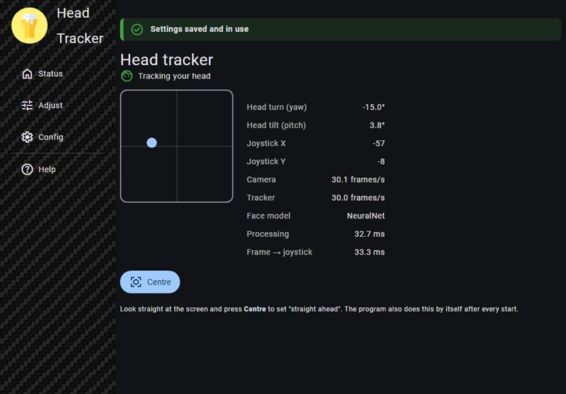

# RPiUSBHeadTracker

A Raspberry Pi head tracker that a PC sees as an ordinary USB joystick.

The Pi is plugged into the PC with a USB cable. It registers as a USB game controller, so games and simulators that can use a joystick need no extra driver or software. A camera on the Pi watches the player, and the program turns the camera picture into joystick movements. A small web interface lets you check the camera picture and change the settings from any browser.

> **Status: work in progress.** The USB joystick, the camera and the web interface work. The actual head tracking (turning the camera picture into X/Y values) is not written yet. For now the joystick sends a test pattern: the stick moves in a circle and the buttons change, so you can check that the PC receives it.

## How it works

```
 camera ──► RPiUSBHeadTracker ──► /dev/hidg0 ──► USB cable ──► PC: "HID-compliant game controller"
                   │
                   └──► web interface (port 18080) ──► browser on PC or phone
```

- **USB joystick:** `headtracker_device.sh` turns the Pi's USB port into a HID joystick (Linux USB gadget). The program writes joystick reports to `/dev/hidg0`: two axes (X, Y, each −127 … 127) and 32 buttons.
- **Camera:** read through libcamera and OpenCV (via the LCCV library).
- **Web interface:** a small built-in web server (Crow) with three pages: Status, Adjust and Config.

## What you need

- **Raspberry Pi 4** (or another Pi whose USB‑C port can work as a USB device, such as the Pi Zero 2 W). Tested on a Pi 4 with Raspberry Pi OS / Debian 12 "bookworm".
- **Raspberry Pi camera**, tested with the Camera Module v2 (IMX219).
- **USB cable** from the Pi's USB‑C port to the PC. The Pi is also powered through this cable.

## Setup on the Pi

### 1. Let the USB port work as a device

Add this line to `/boot/firmware/config.txt` and reboot:

```
dtoverlay=dwc2,dr_mode=peripheral
```

### 2. Install the build tools and libraries

```bash
sudo apt install cmake ninja-build g++ libopencv-dev libcamera-dev libssl-dev libasio-dev
```

CMake 3.24 or newer is needed (bookworm has 3.25).

Optional, for the unit tests:

```bash
sudo apt install libgtest-dev
```

### 3. Build

```bash
cmake -S . -B build -G Ninja -DCMAKE_BUILD_TYPE=Release
ninja -C build
```

The first `cmake` run needs an internet connection: it downloads the libraries listed under [Libraries](#libraries) into `build/_deps`. Later builds in the same build folder use these copies.

### 4. Create the USB joystick

```bash
sudo bash headtracker_device.sh
```

The PC now finds a new game controller called "RaspberryPi Head Tracker". When the script is started with `sudo`, it gives `/dev/hidg0` to your user, so the program can run without root. You can run the script again at any time; if the joystick is already set up, it does nothing. The setup is lost on reboot, so run it again after each start.

### 5. Create the config file

The program reads its settings from `/etc/USBHT.json`, or from the file given with `-c`. Example:

```json
{
   "device": "/dev/hidg0",
   "ip": "0.0.0.0",
   "port": 18080,
   "cam_width": 640,
   "cam_height": 480,
   "cam_framerate": 80.0,
   "cam_verbose": false
}
```

| Key | Meaning |
|---|---|
| `device` | The joystick device created in step 4, normally `/dev/hidg0`. |
| `ip` | Address the web interface listens on. `0.0.0.0` means all network connections of the Pi. Optional. |
| `port` | Port of the web interface. |
| `cam_width`, `cam_height` | Camera picture size in pixels. |
| `cam_framerate` | Camera frames per second. |
| `cam_verbose` | `true` writes detailed camera messages to the log. |

When you press **Save** in the web interface, the program writes this file itself and adds the keys `saved` and `active`. Your user needs write permission for the file.

### 6. Start

Start the program from the build folder, because it loads the web pages from the `templates` and `static` folders there:

```bash
cd build
./RPiUSBHeadTracker -c ~/USBHT.json
```

| Option | Meaning |
|---|---|
| `-c`, `--configfile` | Full path to the config file. Default: `/etc/USBHT.json`. |
| `-h`, `--help` | Show the options. |

Stop it with **Ctrl+C**, or `pkill -x RPiUSBHeadTrack` from another terminal. The program then closes the camera, the web server and the joystick device cleanly. It does not start automatically at boot yet.

## The web interface

Open `http://<address of the Pi>:18080` in a browser on the PC or on a phone in the same network. The menu on the left switches between the pages. On a phone the menu moves to the bottom of the screen.

### Status



The start page. It is a placeholder for now; later it will show the tracker's state.

### Adjust


Shows the live camera picture, updated about ten times per second. Use it to aim the camera at your head. The picture is also available on its own at `/image`.

### Config


All settings from the config file in one form.

| Field | Meaning |
|---|---|
| **Joystick device** | The USB joystick device, normally `/dev/hidg0`. |
| **Web Server Address** | Address the web interface listens on (`0.0.0.0` = all). |
| **Web Server Port** | Port of the web interface. |
| **Device No** | Camera number. Not used yet; the first camera is always used. |
| **Verbose Log** | Writes detailed camera messages to the log. |
| **Width**, **Height** | Camera picture size in pixels. |
| **Framerate** | Camera frames per second. |

The buttons:

- **Reset** puts the form back to the values it showed when the page was loaded. Nothing is sent to the Pi.
- **Apply** uses the new values right away: the program restarts the camera, the web server and the joystick with them. They are not saved, so after a restart of the program the old values from the file are back. If you change the port, the web interface moves to the new port, so open it there.
- **Save** writes the values to the config file. They are used from the next **Apply** or the next start of the program.

On a phone the form uses the whole width and the menu is at the bottom:


### Help

The Help entry in the menu has no page yet.

## Checking the joystick on the PC

On Windows, press **Win+R**, type `joy.cpl` and press Enter. "RaspberryPi Head Tracker" appears in the list of game controllers. Open **Properties** to watch the axes and buttons move. With the current test pattern the crosshair moves in a circle.

On Linux, `jstest /dev/input/js0` (package `joystick`) shows the same.

## Unit tests

The parts that need no camera, web server or USB connection have GoogleTest unit tests: the form parser, the config file and the joystick reports. They are built automatically when `libgtest-dev` is installed:

```bash
ninja -C build
ctest --test-dir build
```

To build without tests, add `-DRPIHT_BUILD_TESTS=OFF` to the `cmake` command.

## Troubleshooting

| Problem | Solution |
|---|---|
| `Permission denied` on `/dev/hidg0` | Run `headtracker_device.sh` with `sudo` from your own user, or run `sudo chown $USER /dev/hidg0`. |
| No game controller on the PC | Check the `dtoverlay=dwc2,dr_mode=peripheral` line, use the Pi's USB‑C port and a data cable (not a charge-only cable), and run `headtracker_device.sh` again. |
| `$'\r': command not found` when running the script | The script has Windows line endings. Check it out again with this repository's `.gitattributes`, or run `sed -i 's/\r$//' headtracker_device.sh`. |
| Web interface does not open | Check the port in the config file and that the program is running. The log shows `Crow/master server is running at …`. |
| No camera picture | Check the camera cable and that `rpicam-hello --list-cameras` (or `libcamera-hello --list-cameras` on older systems) finds the camera. |

## Project layout

| Path | Content |
|---|---|
| `RPiUSBHeadTracker.cpp` | Main program and main loop. |
| `USBJoystick.*` | Writes the joystick reports to `/dev/hidg0`. |
| `RPiHTCam.*` | Camera access. |
| `RPiHTWebApp.*` | Web interface and its routes. |
| `RPiHTConfig.*` | Reads and writes the config file. |
| `QueryParser.*` | Reads the values sent by the Config form. |
| `templates/`, `static/` | Web pages and style sheets. |
| `headtracker_device.sh` | Creates the USB joystick. |
| `tests/` | Unit tests. |

## Libraries

CMake downloads these from GitHub (`FetchContent` in `CMakeLists.txt`). Each one is pinned to a fixed commit and checked against its SHA256, so every build uses exactly the same code. To update a library, change its commit and hash there.

| Library | Used for | Pinned commit |
|---|---|---|
| [Crow](https://github.com/CrowCpp/Crow) | Web server | `6ba7d7f` (master, 2025-10-10) |
| [taocpp/config](https://github.com/taocpp/config) | Reading the config file | `93a455e` (main, 2024-04-13) |
| [taocpp/json](https://github.com/taocpp/json) | JSON, used by config | `11a31e1` (main, 2025-03-11) |
| [taocpp/PEGTL](https://github.com/taocpp/PEGTL) | Parser, used by json | `54a2e32` (main, 2025-05-18) |
| [LCCV](https://github.com/kbarni/LCCV) | Camera access (libcamera + OpenCV); built as a static library and linked into the program | `bca9b3d` (main, 2025-06-12) |
